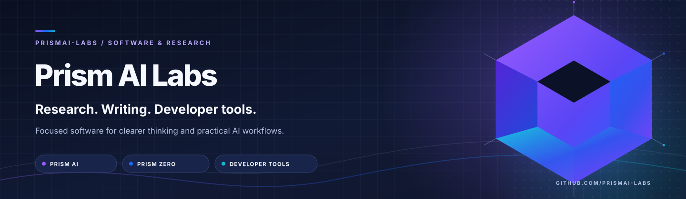
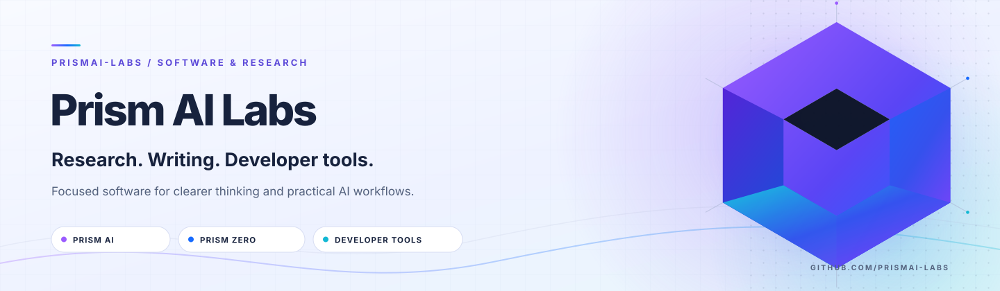

<!-- Prism AI Labs organization profile -->

  
  

  <strong>Research. Writing. Developer tools.</strong> 
  Focused software for clearer thinking and practical AI workflows.

## What we build

### [Prism AI](https://github.com/prismai-labs/Prism-Ai)

A Windows-first research and writing workspace for Markdown and LaTeX. Prism Chat and Prism Studio bring project research, notes, and academic writing into one workflow. It supports local models through Ollama and cloud providers configured with the user's own API key.

Main product · Windows

### [Prism Zero](https://github.com/prismai-labs/prism-zero)

A separate offline-first Python toolkit for generating candidate solutions, checking explicit rules, curating accepted examples, and optionally preparing local LoRA fine-tuning data.

Experimental toolkit · Offline-first

### Developer tooling and documentation

- [Prism SDK](https://github.com/prismai-labs/prism-sdk) — an early-stage TypeScript client helper.
- [Prism Docs](https://github.com/prismai-labs/prism-docs) — the cross-project documentation index.

These supporting components are under development and should not be mistaken for mature hosted services.

## Start here

- [Get Prism AI](https://github.com/prismai-labs/Prism-Ai/releases/latest)
- [Product documentation and handbook](https://github.com/prismai-labs/Prism-Ai/tree/Main/docs)
- [Prism AI browser workspace](https://prismai-labs.github.io/Prism-Ai/)
- [Prism Zero validation notes](https://github.com/prismai-labs/prism-zero/blob/main/VALIDATION.md)
- [Public organization repositories](https://github.com/orgs/prismai-labs/repositories)

## How we work

We keep project maturity, tested capabilities, and limitations explicit. Experimental tools are labelled as such. Product documentation should describe verified behavior, and private application or service credentials do not belong in public repositories.

## Contribute and get support

Read the organization-wide [contribution guide](https://github.com/prismai-labs/.github/blob/main/CONTRIBUTING.md) and [Code of Conduct](https://github.com/prismai-labs/.github/blob/main/CODE_OF_CONDUCT.md). For a security concern, follow the private reporting instructions in [SECURITY.md](https://github.com/prismai-labs/.github/blob/main/SECURITY.md). For product questions and bugs, use the issue tracker in the relevant repository.
