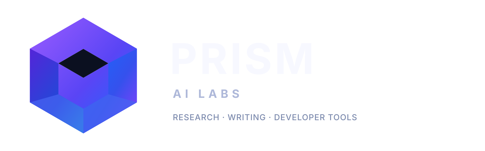
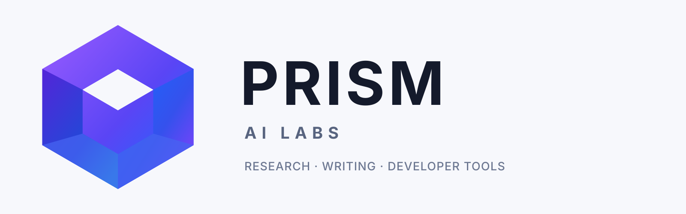

<!-- Prism AI Labs organization profile -->

  
  

  <strong>Research. Writing. Developer tools.</strong> 
  Building focused software for clearer thinking and practical AI workflows.

## What we build

**[Prism AI](https://github.com/prismai-labs/Prism-Ai)** is a Windows-first research and writing workspace for Markdown and LaTeX. It brings project research, notes, and academic writing into one workflow through Prism Chat and Prism Studio. It supports local models through Ollama and cloud providers configured with the user's own API key.

**[Prism Zero](https://github.com/prismai-labs/prism-zero)** is a separate offline-first Python toolkit for generating candidate solutions, checking explicit rules, curating accepted examples, and optionally preparing local LoRA fine-tuning data.

The organization also maintains early-stage developer components: the **[Prism SDK](https://github.com/prismai-labs/prism-sdk)** and a private **Prism MCP server**. These are small foundations under development, not mature hosted services. A separate private web-application prototype is maintained independently from the Windows product.

## Repositories

| Project | Purpose | Status |
| --- | --- | --- |
| [Prism AI](https://github.com/prismai-labs/Prism-Ai) | Windows research and writing workspace | Main product |
| [Prism Zero](https://github.com/prismai-labs/prism-zero) | Offline generation, verification, and dataset curation toolkit | Experimental toolkit |
| [Prism SDK](https://github.com/prismai-labs/prism-sdk) | TypeScript client helper | Early-stage |
| [Prism MCP Server](https://github.com/prismai-labs/prism-mcp-server) | Private TypeScript MCP server scaffold | Private / early-stage |
| [Prism Docs](https://github.com/prismai-labs/prism-docs) | Cross-project documentation workspace | Being organized |
| [TypeScript Starter](https://github.com/prismai-labs/prism-ai-typescript-starter) | Preserved starter scaffold | Template / starter |

## Start here

- [Get Prism AI](https://github.com/prismai-labs/Prism-Ai/releases/latest)
- [Prism AI documentation and handbook](https://github.com/prismai-labs/Prism-Ai/tree/Main/docs)
- [Prism AI browser workspace](https://prismai-labs.github.io/Prism-Ai/)
- [Prism Zero validation notes](https://github.com/prismai-labs/prism-zero/blob/main/VALIDATION.md)

## Contribute and get support

Read the organization-wide [contribution guide](https://github.com/prismai-labs/.github/blob/main/CONTRIBUTING.md) and [Code of Conduct](https://github.com/prismai-labs/.github/blob/main/CODE_OF_CONDUCT.md). For a security concern, follow the private reporting instructions in [SECURITY.md](https://github.com/prismai-labs/.github/blob/main/SECURITY.md). For product questions and bugs, use the issue tracker in the relevant repository.

We keep project maturity, capabilities, and limitations explicit. Experimental components should not be treated as production services, and no private application or service credentials are published here.
